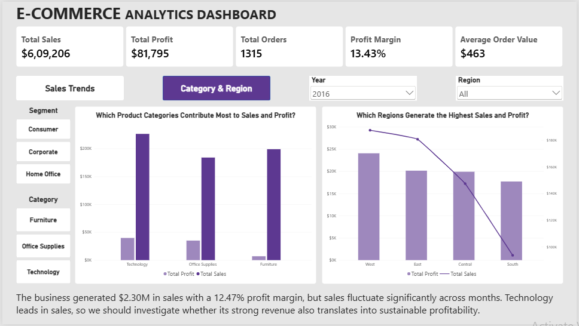
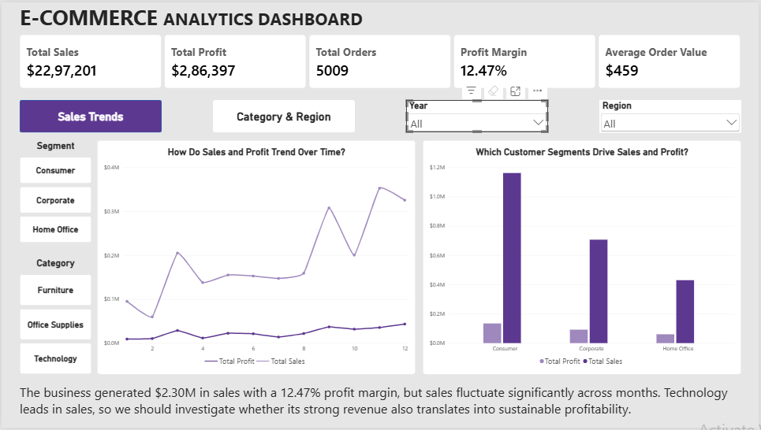
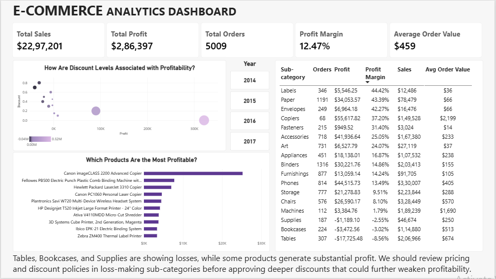
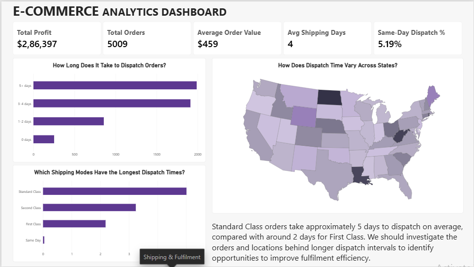

# E-Commerce Sales & Profitability Analysis

An end-to-end data analytics project exploring sales performance, product profitability, discount patterns, regional results, and shipping dispatch intervals using Python, SQL, and Power BI.

## Project Overview

The goal of this project is to help an e-commerce business understand what drives sales and profit, identify products and sub-categories that may require attention, and investigate differences in order dispatch intervals.

The analysis uses the Superstore dataset, with fields including order and shipping dates, customer segments, geography, products, sales, quantity, discount, and profit.

> **Data note:** This is historical sample data. Findings describe patterns in the dataset and should not be interpreted as current market conditions or proof of causation.

## Business Questions

1. Are sales and profits growing, and how does overall business performance vary over time?
2. Which products and product categories generate the most revenue and profit?
3. How are discount levels associated with profitability?
4. Which regions and customer segments contribute most to sales and profit?
5. How do dispatch intervals vary by shipping mode and state?

## Tools & Technologies

- **Python:** data cleaning, exploratory data analysis (EDA), and data validation
- **SQL / PostgreSQL:** aggregations and business-question analysis
- **Power BI:** data modelling with a star schema, DAX measures, interactive visuals, and report pages

## Power BI Report

The report is organised into three pages.

### 1. Executive Overview

Summarises overall sales, profit, order count, profit margin, and average order value. It compares performance across customer segments, months, product categories, and regions.





### 2. Product & Discount Analysis

Examines profitability by sub-category, the relationship between discount levels and profit, and the products with the highest profit. The analysis helps identify loss-making sub-categories and products that may warrant further investigation.



### 3. Shipping & Fulfilment Analysis

Compares dispatch intervals across shipping modes, groups orders by the number of days between order and shipment, and maps average dispatch intervals by state.



## Key Findings

- The report shows approximately **$2.30M in sales**, **$286.4K in profit**, and a **12.47% profit margin** for the displayed overall view.
- Technology leads the displayed categories by sales; sales trends vary across months.
- Tables, Bookcases, and Supplies show negative profit in the displayed sub-category analysis. Confirm the active filters before interpreting these as full-period results.
- Profitability varies across discount levels. The observed relationship is descriptive and does not prove that discounts caused losses.
- Standard Class has an average dispatch interval of approximately **5 days** in the displayed chart, compared with roughly **2 days** for First Class.

## Business Recommendations

- Investigate month-to-month sales changes and compare category-level profitability before making growth or investment decisions.
- Review pricing, discounts, and product performance in loss-making sub-categories before approving deeper discounts.
- Investigate the orders and locations associated with longer dispatch intervals, validating order volumes before prioritising operational changes.

## Important Metric Definitions & Limitations

- **Profit margin** is calculated as total profit divided by total sales.
- **Total orders** should count distinct Order IDs, not transaction rows.
- **Dispatch interval** is the number of days between Order Date and Ship Date. The dataset does not include actual delivery dates or promised delivery dates, so it cannot establish delivery lateness.
- The dataset does not include a separate product-cost field, marketing expenses, or full financial statements. Profit analysis should not be described as net-profit or complete financial-statement analysis.
- Discount analysis shows associations in the historical data; it does not establish causation.

## Repository Structure

```text
project/
├── README.md
├── e-comm_sales_and_profitbility.ipynb
├── e-comm_sales.sql
├── e-comm_sales.pbix
└── dashboard_screenshots/
    ├── executive_overview1.png
    ├── executive_overview2.png
    ├── product_and_discounts.png
    └── shipping_and_fulfilment.png
```


## How to Explore the Project

1. Review the notebook for data cleaning and EDA.
2. Review the SQL queries used to answer the business questions.
3. Open the Power BI report to explore the three pages and use available slicers.
4. Read the findings and limitations before drawing business conclusions.

## Author

Created as a portfolio project to demonstrate practical skills in data analysis, SQL, Python, data modelling, and Power BI dashboard development.
